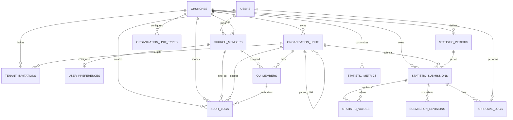

# 02_Database_Design.md

# Church Statistics Management System (CSMS)
## Database Design Specification

Version: 2.0  
Status: Production Blueprint  
Target Platform: Supabase PostgreSQL  
Frontend: SvelteKit + LINE LIFF  
Architecture Style: Multi-Tenant SaaS, Dynamic Metrics, Hierarchical Reporting

---

# 1. Document Purpose

This document defines the database architecture for the Church Statistics Management System (CSMS).

The database is designed to support:

- Multi-tenant churches
- Unlimited organization hierarchy
- Dynamic statistics/KPI collection
- Weekly reporting
- Future approval workflow
- Recursive dashboard aggregation
- OU-based permission control
- Supabase Row Level Security
- Auditability
- Long-term extensibility

This document is written as an AI-first database blueprint so that AI coding tools such as Cursor, Claude Code, Codex, or Gemini CLI can use it as implementation context.

---

# 2. Key Design Decisions

## 2.1 Multi-Tenant Strategy

Decision: Use shared database tables with `church_id` as tenant key.

Reason:

- Simple to implement in Supabase
- Works well with Row Level Security
- Easy to maintain
- Easy to query across tenants for system admin if needed
- Avoids operational complexity of schema-per-tenant

Rule: Every tenant-owned business table must contain `church_id`.

Identity rule: `users` is global. Tenant access is represented by `church_members`, and OU roles reference that tenant membership. The selected `church_id` must be validated server-side and must never be trusted from the client alone.

Canonical detail: See `13_Multi_Tenant_Architecture.md`.

---

## 2.2 Organization Hierarchy Strategy

Decision: Use adjacency list with materialized path.

Fields:

- `parent_id`
- `path`
- `level`

Reason:

- Easy to understand
- Easy to maintain
- Supports recursive queries
- Supports efficient subtree filtering
- Works well with Supabase and PostgreSQL

Optional future enhancement: Use PostgreSQL `ltree` extension if advanced path indexing is required.

---

## 2.3 Data Entry Strategy

Decision: Leaf OU only, with override flag.

Rule:

- If an OU has child OUs, it should normally not accept direct statistics input.
- If an OU has no child OUs, it can accept statistics input.
- `allow_data_entry` may override this behavior when needed.
- A direct submission always represents only that OU's own activity. Recursive totals sum each approved reporting-OU submission once and never add a stored parent rollup.

Reason:

- Prevents duplicate counting
- Keeps aggregation clean
- Supports exceptional church structures

---

## 2.4 Metric Strategy

Decision: Use dynamic metric model.

Instead of fixed columns such as `attendance`, `sunday_school`, `new_visitor`, and `new_believer`, use:

- `statistic_metrics`
- `statistic_values`

Reason:

- Churches may track different statistics
- New KPIs can be added without database migration
- Reports and forms can be generated dynamically
- Supports future finance, ministry, online, youth, and custom metrics

---

## 2.5 Metric Scope

Decision: Platform metrics are versioned provisioning templates. Runtime submission metrics are always tenant-owned.

Rule:

- Platform template changes never mutate an existing tenant form.
- Provisioning copies a selected template version into rows with non-null `church_id`.
- Tenant Root Admins may rename, reorder, add, or deactivate their copied metrics.
- Template provenance is retained for upgrade comparison but never grants cross-tenant access.

---

## 2.6 Approval Strategy

Decision: Approval applies per submission, not per metric.

Reason:

- Easier workflow
- Easier user experience
- Better fit for weekly report approval
- Avoids partial approval complexity

---

## 2.7 Dashboard Aggregation Strategy

Decision: Dashboard includes approved records only.

Phase 1 exception:

Before approval workflow is enabled, submitted records are automatically marked as approved.

---

## 2.8 Delete Strategy

Decision: Use soft delete for important business records.

Soft-delete fields:

- `is_active`
- `deleted_at`
- `deleted_by`

Reason:

- Preserve historical reporting
- Preserve audit integrity
- Avoid orphan data
- Support restore if needed

---

## 2.9 Audit Strategy

Decision: Use event-based audit with `before_data` and `after_data` JSONB.

Reason:

- Traceability
- Accountability
- Debugging
- Compliance
- Approval investigation

---

# 3. Database Modules

The database is organized into the following modules:

```text
1. Tenant
2. Identity
3. Organization Hierarchy
4. Permission
5. Reporting Period
6. Dynamic Metrics
7. Submissions
8. Approval
9. Dashboard Views
10. Audit
```

---

# 4. Entity Relationship Diagram



---

# 5. Table Catalog

| Table | Purpose |
|---|---|
| `churches` | Tenant master table |
| `users` | Global LINE/Supabase identities |
| `church_members` | User membership and status per tenant |
| `tenant_invitations` | One-time tenant/OU role invitations |
| `user_preferences` | Per-membership tenant UI preferences |
| `organization_unit_types` | Tenant-wide configurable OU types |
| `organization_units` | Hierarchical church structure |
| `ou_members` | User permissions per OU |
| `statistic_periods` | Canonical weekly submission periods |
| `metric_template_sets` | Versioned platform provisioning templates |
| `statistic_metrics` | Dynamic KPI definitions |
| `statistic_submissions` | Submission header per OU/period |
| `statistic_values` | Metric values per submission |
| `submission_revisions` | Immutable submission/value snapshots per revision |
| `api_idempotency_keys` | Retry-safe mutation request/result records |
| `approval_logs` | Approval workflow history |
| `audit_logs` | Append-only tenant and platform audit trail |

---

# 6. Naming Convention

## 6.1 Database

Use snake_case.

Examples:

```text
organization_units
statistic_submissions
created_at
approved_by
```

## 6.2 Primary Key

Every table uses:

```sql
id uuid primary key default gen_random_uuid()
```

## 6.3 Timestamp

Use:

```sql
created_at timestamptz not null default now()
updated_at timestamptz not null default now()
deleted_at timestamptz null
```

## 6.4 Soft Delete

Use:

```sql
is_active boolean not null default true
deleted_at timestamptz null
deleted_by uuid null
```

---

# 7. PostgreSQL Extensions

Recommended Supabase extensions:

```sql
create extension if not exists "pgcrypto";
create extension if not exists "uuid-ossp";
```

Optional:

```sql
create extension if not exists "ltree";
```

Use `ltree` only if path query performance becomes important.

---

# 8. Table Definitions

## 8.1 `churches`

Stores tenant-level church information.

| Field | Type | Nullable | Default | Description |
|---|---|---:|---|---|
| `id` | uuid | No | gen_random_uuid() | Primary key |
| `code` | varchar(50) | No | | Unique church code |
| `slug` | varchar(100) | No | | Unique URL-safe tenant slug |
| `name` | varchar(255) | No | | Church name |
| `description` | text | Yes | | Description |
| `timezone` | varchar(100) | No | Asia/Bangkok | Tenant timezone |
| `approval_mode` | varchar(30) | No | auto_approve | auto_approve or approval_required |
| `reporting_week_ends_on` | smallint | No | 0 | Calculation period-end weekday, PostgreSQL convention 0=Sunday |
| `submission_deadline_days_after_period_end` | smallint | No | 1 | Local calendar days after `period_end` before normal submission closes; 1–6 |
| `primary_metric_id` | uuid | Yes | | Tenant dashboard primary metric |
| `status` | varchar(30) | No | provisioning | provisioning, trial, active, suspended, closed |
| `trial_ends_at` | timestamptz | Yes | | Trial expiration |
| `is_active` | boolean | No | true | Derived operational flag; false for suspended/closed |
| `created_at` | timestamptz | No | now() | Created time |
| `updated_at` | timestamptz | No | now() | Updated time |
| `deleted_at` | timestamptz | Yes | | Soft delete time |
| `deleted_by` | uuid | Yes | | User who deleted |

Constraints:

```sql
alter table churches add constraint uq_churches_code unique (code);
alter table churches add constraint uq_churches_slug unique (slug);
alter table churches add constraint ck_churches_status check (status in ('provisioning', 'trial', 'active', 'suspended', 'closed'));
alter table churches add constraint ck_churches_approval_mode check (approval_mode in ('auto_approve', 'approval_required'));
alter table churches add constraint ck_churches_week_end check (reporting_week_ends_on between 0 and 6);
alter table churches add constraint ck_churches_submission_deadline_days check (submission_deadline_days_after_period_end between 1 and 6);
```

---

## 8.2 `users`

Stores global LINE/Supabase user profiles. Tenant access is not granted by this table.

| Field | Type | Nullable | Default | Description |
|---|---|---:|---|---|
| `id` | uuid | No | gen_random_uuid() | Primary key |
| `auth_user_id` | uuid | No | | Unique Supabase Auth identity |
| `last_active_church_id` | uuid | Yes | | UI preference only; never grants access |
| `line_user_id` | varchar(150) | No | | LINE user ID |
| `display_name` | varchar(255) | No | | LINE display name |
| `picture_url` | text | Yes | | LINE profile image |
| `email` | varchar(255) | Yes | | Optional email |
| `phone` | varchar(50) | Yes | | Optional phone |
| `global_role` | varchar(30) | No | user | system_admin or user |
| `is_active` | boolean | No | true | Active flag |
| `last_login_at` | timestamptz | Yes | | Last login |
| `created_at` | timestamptz | No | now() | Created time |
| `updated_at` | timestamptz | No | now() | Updated time |
| `deleted_at` | timestamptz | Yes | | Soft delete |
| `deleted_by` | uuid | Yes | | Deleted by |

Constraints:

```sql
alter table users add constraint uq_users_auth_user_id unique (auth_user_id);
alter table users add constraint uq_users_line_user_id unique (line_user_id);
alter table users add constraint ck_users_global_role check (global_role in ('system_admin', 'user'));
```

---

## 8.2A `church_members`

Connects a global user to a tenant. Access requires an active membership.

Required fields: `id`, `church_id`, `user_id`, `status`, `joined_at`, `created_by`, `created_at`, and `updated_at`.

Constraints:

- unique `(church_id, user_id)`
- `status` is `invited`, `active`, `suspended`, or `revoked`
- authorization requires `status = 'active'`
- tenant ownership is immutable

---

## 8.2AA `tenant_invitations`

Stores one-time invitations that bind a future authenticated LINE identity to a tenant/OU role without creating a placeholder `users` row.

Required fields: `id`, `church_id`, `email`, `display_name`, `target_ou_id`, `permission`, `token_hash`, `status`, `expires_at`, invitation/acceptance audit fields, and timestamps.

Rules:

- Store only a cryptographic hash of the invitation token.
- The raw token is delivered once and never logged.
- Accepting requires an authenticated, validated LINE/Supabase identity plus the unexpired token; LINE email is not required to match because LINE may not provide one.
- Acceptance transaction creates or reuses `church_members`, creates the intended `ou_members` assignment, marks the invitation accepted, and writes an audit log.
- Only one pending, unexpired invitation per tenant/email/target OU/permission is allowed.
- Tenant provisioning initially creates a Root OU admin invitation. It must not create a placeholder `users` row.

---

## 8.2AB `user_preferences`

Tenant-specific preferences for one active church membership.

Fields: `church_id`, `church_member_id`, optional `default_ou_id`, `language`, `landing_page`, notification flags, and timestamps.

Rules:

- unique `(church_id, church_member_id)`
- default OU must belong to the same tenant and be visible to the member when saved
- preferences never grant OU or tenant access
- notification flags may be saved before Phase 3 delivery is enabled

---

## 8.2B `organization_unit_types`

Stores configurable OU type labels shared by the entire tenant structure.

Required fields: `id`, `church_id`, `code`, `name`, `description`, `sort_order`, `default_allow_data_entry`, `is_active`, and audit fields.

| Field | Type | Nullable | Default | Description |
|---|---|---:|---|---|
| `id` | uuid | No | gen_random_uuid() | Primary key |
| `church_id` | uuid | No | | Tenant |
| `code` | varchar(50) | No | | Stable tenant-specific code |
| `name` | varchar(150) | No | | Display name |
| `description` | text | Yes | | Description |
| `sort_order` | integer | No | 0 | Selection-list order; does not define tree level |
| `default_allow_data_entry` | boolean | No | false | Initial value copied to a newly created OU |
| `is_active` | boolean | No | true | Available for new OU selection |
| `created_by` | uuid | Yes | | Actor who created the type |
| `created_at` | timestamptz | No | now() | Created time |
| `updated_at` | timestamptz | No | now() | Last update time |
| `deleted_at` | timestamptz | Yes | | Soft delete time |
| `deleted_by` | uuid | Yes | | Actor who soft deleted the type |

Constraints:

- unique `(church_id, code)`
- `sort_order >= 0`
- only a direct Root OU Level 1 admin may manage this tenant-wide setting
- used types are deactivated instead of deleted
- when `deleted_at` is populated, `is_active` must be false

---
## 8.3 `organization_units`

Stores church hierarchy.

| Field | Type | Nullable | Default | Description |
|---|---|---:|---|---|
| `id` | uuid | No | gen_random_uuid() | Primary key |
| `church_id` | uuid | No | | Tenant |
| `structure_root_id` | uuid | No | | Tenant Root OU |
| `parent_id` | uuid | Yes | | Parent OU |
| `ou_type_id` | uuid | No | | Tenant OU type |
| `code` | varchar(50) | No | | OU code |
| `name` | varchar(255) | No | | OU name |
| `description` | text | Yes | | Description |
| `path` | text | No | | Materialized path |
| `level` | integer | No | 1 | Tree depth; root starts at Level 1 |
| `sort_order` | integer | No | 0 | UI order |
| `allow_data_entry` | boolean | No | false | Can submit data |
| `is_active` | boolean | No | true | Active flag |
| `created_by` | uuid | Yes | | Creator |
| `created_at` | timestamptz | No | now() | Created time |
| `updated_at` | timestamptz | No | now() | Updated time |
| `deleted_at` | timestamptz | Yes | | Soft delete |
| `deleted_by` | uuid | Yes | | Deleted by |

Rules:

- Each tenant has exactly one active Root OU with `parent_id IS NULL`, `level = 1`, and `structure_root_id = id`.
- Child OU, parent OU, structure root, and OU type must belong to the same `church_id`.
- `path` should include all ancestor IDs or generated path tokens.
- Parent OU usually has `allow_data_entry = false`.
- Leaf OU usually has `allow_data_entry = true`.
- If a parent is explicitly enabled, its direct submission is additive to descendant submissions and must contain parent-only activity.

Example path:

```text
/root-ou-id/region-id/district-id/group-id
```

Constraints:

```sql
alter table organization_units add constraint uq_ou_code_per_church unique (church_id, code);
alter table organization_units add constraint ck_ou_level_positive check (level >= 1);
```

---

## 8.4 `ou_members`

Stores user permission assignments per OU.

| Field | Type | Nullable | Default | Description |
|---|---|---:|---|---|
| `id` | uuid | No | gen_random_uuid() | Primary key |
| `church_id` | uuid | No | | Tenant |
| `ou_id` | uuid | No | | Organization Unit |
| `church_member_id` | uuid | No | | Active tenant membership |
| `permission` | varchar(30) | No | | Permission |
| `can_override` | boolean | No | false | Can approve lower OU by override |
| `is_active` | boolean | No | true | Active flag |
| `assigned_by` | uuid | Yes | | Assigned by |
| `assigned_at` | timestamptz | No | now() | Assigned time |
| `created_at` | timestamptz | No | now() | Created time |
| `updated_at` | timestamptz | No | now() | Updated time |
| `deleted_at` | timestamptz | Yes | | Soft delete |
| `deleted_by` | uuid | Yes | | Deleted by |

Permission values:

| Permission | Meaning |
|---|---|
| `admin` | Full assigned-subtree admin; tenant-wide only when assigned to Root OU |
| `manager` | Manage assigned OU and child OU |
| `data_entry` | Input statistics |
| `approver` | Approve submissions |
| `viewer` | Read-only access |

Constraints:

```sql
alter table ou_members add constraint uq_ou_member_permission unique (church_id, ou_id, church_member_id, permission);
alter table ou_members add constraint ck_ou_members_permission check (permission in ('admin', 'manager', 'data_entry', 'approver', 'viewer'));
alter table ou_members add constraint ck_ou_members_override_role check (can_override = false or permission = 'approver');
```

---

## 8.5 `statistic_periods`

Defines canonical reporting weeks. Monthly, quarterly, yearly, and custom date-range reports aggregate weekly submissions and do not create additional submission periods in MVP.

| Field | Type | Nullable | Default | Description |
|---|---|---:|---|---|
| `id` | uuid | No | gen_random_uuid() | Primary key |
| `church_id` | uuid | No | | Tenant |
| `period_type` | varchar(20) | No | week | `week` for submission periods |
| `year` | integer | No | | Year |
| `week_no` | integer | Yes | | ISO week number |
| `month_no` | integer | Yes | | Month number |
| `period_start` | date | No | | Start date |
| `period_end` | date | No | | End date |
| `label` | varchar(100) | No | | Stable canonical label such as `2026-W27`; UI displays localized `period_end` |
| `status` | varchar(30) | No | open | Period status |
| `submission_opens_at` | timestamptz | Yes | | Snapshotted instant when normal data entry opens |
| `submission_due_at` | timestamptz | Yes | | Snapshotted inclusive deadline for normal submission |
| `created_at` | timestamptz | No | now() | Created time |
| `updated_at` | timestamptz | No | now() | Updated time |

Status values:

```text
open
closed
locked
```

Rules:

- A calculation week is exactly seven inclusive dates and ends on `churches.reporting_week_ends_on`.
- Canonical generated periods snapshot `submission_opens_at` at local 00:00 on `period_end` and `submission_due_at` at local end-of-day after the configured deadline offset.
- The deadline controls normal write eligibility, default UI state, and missing reminders; it never changes calculation or aggregation boundaries.
- `year` and `week_no` use ISO year/week derived from `period_end`; UI does not show week number as the primary label.
- Submission RPCs accept only `period_type = 'week'`.
- A week is assigned to a month/quarter/year by `period_end`.
- Period status is an administrative lock independent of the time window. Normal late submissions are rejected; an authorized `returned` correction may bypass the time deadline only while status remains `open`.

Constraints:

```sql
alter table statistic_periods add constraint ck_period_type check (period_type = 'week');
alter table statistic_periods add constraint ck_period_status check (status in ('open', 'closed', 'locked'));
alter table statistic_periods add constraint ck_week_period_shape check (
  week_no between 1 and 53
  and month_no is null
  and period_end = period_start + 6
);
alter table statistic_periods add constraint uq_period_per_church unique (church_id, period_start);
alter table statistic_periods add constraint ck_statistic_periods_submission_window check (
  (submission_opens_at is null and submission_due_at is null)
  or (submission_opens_at is not null and submission_due_at is not null and submission_due_at >= submission_opens_at)
);
```

---

## 8.6 `statistic_metrics`

Defines dynamic KPIs.

| Field | Type | Nullable | Default | Description |
|---|---|---:|---|---|
| `id` | uuid | No | gen_random_uuid() | Primary key |
| `church_id` | uuid | No | | Owning tenant |
| `source_template_set_id` | uuid | Yes | | Provisioning template provenance |
| `source_template_code` | varchar(80) | Yes | | Original template metric code |
| `code` | varchar(80) | No | | Metric code |
| `name` | varchar(255) | No | | Display name |
| `description` | text | Yes | | Description |
| `category` | varchar(80) | No | | attendance, finance, ministry |
| `unit` | varchar(50) | No | count | count, person, THB, percent |
| `data_type` | varchar(30) | No | number | number, text, boolean |
| `input_type` | varchar(30) | No | number | number, text, checkbox |
| `aggregation` | varchar(30) | No | sum | sum, avg, max, min, none |
| `default_value` | numeric | Yes | | Optional default numeric |
| `min_value` | numeric | Yes | | Validation |
| `max_value` | numeric | Yes | | Validation |
| `is_required` | boolean | No | false | Required input |
| `sort_order` | integer | No | 0 | UI order |
| `is_active` | boolean | No | true | Active flag |
| `created_at` | timestamptz | No | now() | Created time |
| `updated_at` | timestamptz | No | now() | Updated time |
| `deleted_at` | timestamptz | Yes | | Soft delete |
| `deleted_by` | uuid | Yes | | Deleted by |

Example metrics:

| Code | Name | Category | Unit | Aggregation |
|---|---|---|---|---|
| `ATTENDANCE` | Worship Attendance | attendance | person | sum |
| `SUNDAY_SCHOOL` | Sunday School | attendance | person | sum |
| `NEW_VISITOR` | New Visitors | attendance | person | sum |
| `NEW_BELIEVER` | New Believers | ministry | person | sum |
| `ONLINE` | Online Attendance | attendance | person | sum |
| `OFFERING` | Offering | finance | THB | sum |
| `BAPTISM` | Baptism | ministry | person | sum |

Constraints:

```sql
alter table statistic_metrics add constraint uq_metric_code_per_church unique (church_id, code);
alter table statistic_metrics add constraint ck_metric_data_type check (data_type in ('number', 'text', 'boolean'));
alter table statistic_metrics add constraint ck_metric_input_type check (
  input_type = case data_type when 'number' then 'number' when 'text' then 'text' else 'checkbox' end
);
alter table statistic_metrics add constraint ck_metric_aggregation check (aggregation in ('sum', 'avg', 'max', 'min', 'none'));
alter table statistic_metrics add constraint ck_metric_range check (min_value is null or max_value is null or min_value <= max_value);
alter table statistic_metrics add constraint ck_metric_default_range check (
  default_value is null
  or (
    data_type = 'number'
    and (min_value is null or default_value >= min_value)
    and (max_value is null or default_value <= max_value)
  )
);

Tenant runtime metrics are unique by `(church_id, code)`. Platform template definitions are stored separately in `metric_template_sets`.
```

---

## 8.7 `statistic_submissions`

Submission header table.

| Field | Type | Nullable | Default | Description |
|---|---|---:|---|---|
| `id` | uuid | No | gen_random_uuid() | Primary key |
| `church_id` | uuid | No | | Tenant |
| `period_id` | uuid | No | | Reporting period |
| `ou_id` | uuid | No | | Reporting OU |
| `status` | varchar(30) | No | draft | Workflow state |
| `submitted_by` | uuid | Yes | | Submitter |
| `submitted_at` | timestamptz | Yes | | Submit time |
| `approved_by` | uuid | Yes | | Approver |
| `approved_at` | timestamptz | Yes | | Approve time |
| `rejected_by` | uuid | Yes | | Reject user |
| `rejected_at` | timestamptz | Yes | | Reject time |
| `returned_by` | uuid | Yes | | Return user |
| `returned_at` | timestamptz | Yes | | Return time |
| `revision_no` | integer | No | 1 | Revision |
| `remarks` | text | Yes | | Submitter remarks |
| `approval_note` | text | Yes | | Approver note |
| `created_at` | timestamptz | No | now() | Created time |
| `updated_at` | timestamptz | No | now() | Updated time |
| `deleted_at` | timestamptz | Yes | | Soft delete |
| `deleted_by` | uuid | Yes | | Deleted by |

Status values:

| Status | Meaning |
|---|---|
| `draft` | Editable by data entry |
| `submitted` | Waiting for approval |
| `approved` | Included in official reports |
| `rejected` | Rejected and not counted |
| `returned` | Returned for correction |

Constraints:

```sql
alter table statistic_submissions add constraint uq_submission_per_period_ou unique (church_id, period_id, ou_id);
alter table statistic_submissions add constraint ck_submission_status check (status in ('draft', 'submitted', 'approved', 'rejected', 'returned'));
alter table statistic_submissions add constraint ck_revision_positive check (revision_no >= 1);
alter table statistic_submissions add constraint ck_submission_actor_timestamps check (
  (submitted_by is null) = (submitted_at is null)
  and (approved_by is null) = (approved_at is null)
  and (rejected_by is null) = (rejected_at is null)
  and (returned_by is null) = (returned_at is null)
);
alter table statistic_submissions add constraint ck_submission_status_timestamps check (
  (status = 'draft' and submitted_at is null and approved_at is null and rejected_at is null and returned_at is null)
  or (status = 'submitted' and submitted_at is not null and approved_at is null and rejected_at is null and returned_at is null)
  or (status = 'approved' and submitted_at is not null and approved_at is not null and rejected_at is null and returned_at is null)
  or (status = 'rejected' and submitted_at is not null and rejected_at is not null and returned_at is null)
  or (status = 'returned' and submitted_at is not null and returned_at is not null and rejected_at is null)
);
```

`approval_mode = auto_approve` rule:

```text
status = approved
submitted_by = current_user
submitted_at = now()
approved_by = current_user
approved_at = now()
```

---

## 8.8 `statistic_values`

Stores metric values.

| Field | Type | Nullable | Default | Description |
|---|---|---:|---|---|
| `id` | uuid | No | gen_random_uuid() | Primary key |
| `church_id` | uuid | No | | Tenant |
| `submission_id` | uuid | No | | Submission |
| `metric_id` | uuid | No | | Metric |
| `numeric_value` | numeric(18,2) | Yes | | Number value |
| `text_value` | text | Yes | | Text value |
| `boolean_value` | boolean | Yes | | Boolean value |
| `created_at` | timestamptz | No | now() | Created time |
| `updated_at` | timestamptz | No | now() | Updated time |

Constraints:

```sql
alter table statistic_values add constraint uq_value_per_submission_metric unique (church_id, submission_id, metric_id);
alter table statistic_values add constraint ck_statistic_value_one_field check (
  num_nonnulls(numeric_value, text_value, boolean_value) = 1
);
```

The write RPC must additionally lock and read the referenced metric, then verify that the populated field matches its `data_type`. The database trigger in the full DDL enforces the same rule so it cannot be bypassed.

---

## 8.8A `submission_revisions`

Immutable submission snapshots used for audit, conflict recovery, and revision comparison. One row is written in the same transaction for every successful draft save, submit, return/resubmit, or privileged correction. It stores `revision_no`, workflow status, remarks, a JSONB value snapshot, actor, and timestamp. `(church_id, submission_id, revision_no)` is unique.

## 8.8B `api_idempotency_keys`

Stores the result of retry-safe mutation requests. The client supplies a UUID `clientRequestId`; uniqueness is `(church_id, actor_user_id, operation, client_request_id)`. Store a request hash, response JSON, status code, and expiry. Reusing the key with a different request hash is rejected.

---

## 8.9 `approval_logs`

Stores approval workflow history.

| Field | Type | Nullable | Default | Description |
|---|---|---:|---|---|
| `id` | uuid | No | gen_random_uuid() | Primary key |
| `church_id` | uuid | No | | Tenant |
| `submission_id` | uuid | No | | Submission |
| `action` | varchar(30) | No | | Action |
| `action_by` | uuid | No | | User |
| `from_status` | varchar(30) | Yes | | Previous status |
| `to_status` | varchar(30) | Yes | | New status |
| `is_override` | boolean | No | false | Override flag |
| `reason` | text | Yes | | Reason/comment |
| `created_at` | timestamptz | No | now() | Action time |

Action values:

```text
create
save_draft
submit
approve
reject
return_draft
edit_approved
override_approve
```

---

## 8.10 `audit_logs`

Append-only audit table for tenant-scoped and platform events.

| Field | Type | Nullable | Default | Description |
|---|---|---:|---|---|
| `id` | uuid | No | gen_random_uuid() | Primary key |
| `church_id` | uuid | Yes | | Tenant |
| `user_id` | uuid | Yes | | Actor |
| `actor_church_member_id` | uuid | Yes | | Actor membership in the target tenant |
| `ou_id` | uuid | Yes | | OU scope used for authorization |
| `source_ou_member_id` | uuid | Yes | | Assignment that authorized the action |
| `entity_type` | varchar(100) | No | | Table/module |
| `entity_id` | uuid | Yes | | Entity ID |
| `action` | varchar(100) | No | | Action |
| `before_data` | jsonb | Yes | | Before state |
| `after_data` | jsonb | Yes | | After state |
| `metadata` | jsonb | No | `{}` | Safe structured context |
| `request_id` | uuid | Yes | | Request/trace correlation ID |
| `ip_address` | inet | Yes | | IP address |
| `user_agent` | text | Yes | | Browser/device |
| `created_at` | timestamptz | No | now() | Created time |

Rules:

- Tenant operations must populate `church_id` and the affected `ou_id` when an OU scope exists.
- `actor_church_member_id` records the actor's membership in that tenant and must identify the same global user as `user_id`; it may be null only for an authorized platform/system operation.
- Inherited OU administration must populate `source_ou_member_id`; the composite foreign key guarantees that the source assignment belongs to the actor membership.
- Audit rows are append-only. Authenticated clients cannot insert, update, or delete them directly.
- Sensitive secrets, tokens, and unredacted personal payloads must never be stored in `before_data`, `after_data`, or `metadata`.

---

# 9. Full SQL DDL

```sql
create extension if not exists "pgcrypto";

create table churches (
    id uuid primary key default gen_random_uuid(),
    code varchar(50) not null unique,
    slug varchar(100) not null unique,
    name varchar(255) not null,
    description text,
    timezone varchar(100) not null default 'Asia/Bangkok',
    approval_mode varchar(30) not null default 'auto_approve',
    reporting_week_ends_on smallint not null default 0,
    submission_deadline_days_after_period_end smallint not null default 1,
    primary_metric_id uuid,
    status varchar(30) not null default 'provisioning',
    trial_ends_at timestamptz,
    is_active boolean not null default true,
    created_at timestamptz not null default now(),
    updated_at timestamptz not null default now(),
    deleted_at timestamptz,
    deleted_by uuid,
    constraint ck_churches_status check (status in ('provisioning', 'trial', 'active', 'suspended', 'closed')),
    constraint ck_churches_approval_mode check (approval_mode in ('auto_approve', 'approval_required')),
    constraint ck_churches_week_end check (reporting_week_ends_on between 0 and 6),
    constraint ck_churches_submission_deadline_days check (submission_deadline_days_after_period_end between 1 and 6),
    constraint ck_churches_active_status check (
        (status in ('provisioning', 'trial', 'active') and is_active = true)
        or (status in ('suspended', 'closed') and is_active = false)
    )
);

create table users (
    id uuid primary key default gen_random_uuid(),
    auth_user_id uuid not null unique,
    last_active_church_id uuid references churches(id),
    line_user_id varchar(150) not null unique,
    display_name varchar(255) not null,
    picture_url text,
    email varchar(255),
    phone varchar(50),
    global_role varchar(30) not null default 'user',
    is_active boolean not null default true,
    last_login_at timestamptz,
    created_at timestamptz not null default now(),
    updated_at timestamptz not null default now(),
    deleted_at timestamptz,
    deleted_by uuid,
    constraint ck_users_global_role check (global_role in ('system_admin', 'user'))
);

create table church_members (
    id uuid primary key default gen_random_uuid(),
    church_id uuid not null references churches(id),
    user_id uuid not null references users(id),
    status varchar(20) not null default 'active',
    joined_at timestamptz,
    created_by uuid references users(id),
    created_at timestamptz not null default now(),
    updated_at timestamptz not null default now(),
    constraint uq_church_member unique (church_id, user_id),
    constraint uq_church_member_church_id unique (church_id, id),
    constraint uq_church_member_actor unique (church_id, id, user_id),
    constraint ck_church_member_status check (status in ('invited', 'active', 'suspended', 'revoked'))
);

create table organization_unit_types (
    id uuid primary key default gen_random_uuid(),
    church_id uuid not null references churches(id),
    code varchar(50) not null,
    name varchar(150) not null,
    description text,
    sort_order integer not null default 0,
    default_allow_data_entry boolean not null default false,
    is_active boolean not null default true,
    created_by uuid references users(id),
    created_at timestamptz not null default now(),
    updated_at timestamptz not null default now(),
    deleted_at timestamptz,
    deleted_by uuid references users(id),
    constraint uq_ou_type_code_per_church unique (church_id, code),
    constraint uq_ou_type_church_id unique (church_id, id),
    constraint ck_ou_type_sort_order_nonnegative check (sort_order >= 0),
    constraint ck_ou_type_deleted_inactive check (deleted_at is null or is_active = false)
);
create table organization_units (
    id uuid primary key default gen_random_uuid(),
    church_id uuid not null references churches(id),
    structure_root_id uuid not null,
    parent_id uuid,
    ou_type_id uuid not null,
    code varchar(50) not null,
    name varchar(255) not null,
    description text,
    path text not null,
    level integer not null default 1,
    sort_order integer not null default 0,
    allow_data_entry boolean not null default false,
    is_active boolean not null default true,
    created_by uuid references users(id),
    created_at timestamptz not null default now(),
    updated_at timestamptz not null default now(),
    deleted_at timestamptz,
    deleted_by uuid references users(id),
    constraint uq_ou_code_per_church unique (church_id, code),
    constraint uq_ou_church_id unique (church_id, id),
    constraint ck_ou_level_positive check (level >= 1),
    constraint fk_ou_parent_same_church
        foreign key (church_id, parent_id)
        references organization_units(church_id, id),
    constraint fk_ou_root_same_church
        foreign key (church_id, structure_root_id)
        references organization_units(church_id, id),
    constraint fk_ou_type_same_church
        foreign key (church_id, ou_type_id)
        references organization_unit_types(church_id, id)
);

create table tenant_invitations (
    id uuid primary key default gen_random_uuid(),
    church_id uuid not null references churches(id),
    email varchar(255) not null,
    display_name varchar(255),
    target_ou_id uuid not null,
    permission varchar(30) not null,
    can_override boolean not null default false,
    token_hash text not null unique,
    status varchar(20) not null default 'pending',
    expires_at timestamptz not null,
    invited_by uuid not null references users(id),
    accepted_by uuid references users(id),
    accepted_at timestamptz,
    revoked_by uuid references users(id),
    revoked_at timestamptz,
    created_at timestamptz not null default now(),
    updated_at timestamptz not null default now(),
    constraint ck_tenant_invitation_permission check (permission in ('admin', 'manager', 'data_entry', 'approver', 'viewer')),
    constraint ck_tenant_invitation_override_role check (can_override = false or permission = 'approver'),
    constraint ck_tenant_invitation_status check (status in ('pending', 'accepted', 'expired', 'revoked')),
    constraint ck_tenant_invitation_expiry check (expires_at > created_at),
    constraint fk_tenant_invitation_ou_same_church
        foreign key (church_id, target_ou_id)
        references organization_units(church_id, id)
);

create unique index uq_pending_tenant_invitation
on tenant_invitations(church_id, lower(email), target_ou_id, permission)
where status = 'pending';

create table user_preferences (
    id uuid primary key default gen_random_uuid(),
    church_id uuid not null references churches(id),
    church_member_id uuid not null,
    default_ou_id uuid,
    language varchar(10) not null default 'th',
    landing_page varchar(100) not null default '/app/dashboard',
    notify_missing boolean not null default true,
    notify_submitted boolean not null default true,
    notify_approval boolean not null default true,
    notify_email boolean not null default false,
    created_at timestamptz not null default now(),
    updated_at timestamptz not null default now(),
    constraint uq_user_preference_membership unique (church_id, church_member_id),
    constraint ck_user_preference_language check (language in ('th', 'en')),
    constraint ck_user_preference_landing check (landing_page in ('/app/dashboard', '/app/organization', '/app/submissions', '/app/reports')),
    constraint fk_user_preference_membership_same_church
        foreign key (church_id, church_member_id)
        references church_members(church_id, id),
    constraint fk_user_preference_ou_same_church
        foreign key (church_id, default_ou_id)
        references organization_units(church_id, id)
);

create table ou_members (
    id uuid primary key default gen_random_uuid(),
    church_id uuid not null references churches(id),
    ou_id uuid not null,
    church_member_id uuid not null,
    permission varchar(30) not null,
    can_override boolean not null default false,
    is_active boolean not null default true,
    assigned_by uuid references users(id),
    assigned_at timestamptz not null default now(),
    created_at timestamptz not null default now(),
    updated_at timestamptz not null default now(),
    deleted_at timestamptz,
    deleted_by uuid references users(id),
    constraint uq_ou_member_church_id unique (church_id, id),
    constraint uq_ou_member_authorization_source unique (church_id, id, church_member_id),
    constraint uq_ou_member_permission unique (church_id, ou_id, church_member_id, permission),
    constraint ck_ou_members_permission check (permission in ('admin', 'manager', 'data_entry', 'approver', 'viewer')),
    constraint ck_ou_members_override_role check (can_override = false or permission = 'approver'),
    constraint fk_ou_member_ou_same_church
        foreign key (church_id, ou_id)
        references organization_units(church_id, id),
    constraint fk_ou_member_membership_same_church
        foreign key (church_id, church_member_id)
        references church_members(church_id, id)
);

create table statistic_periods (
    id uuid primary key default gen_random_uuid(),
    church_id uuid not null references churches(id),
    period_type varchar(20) not null default 'week',
    year integer not null,
    week_no integer,
    month_no integer,
    period_start date not null,
    period_end date not null,
    submission_opens_at timestamptz,
    submission_due_at timestamptz,
    label varchar(100) not null,
    status varchar(30) not null default 'open',
    created_at timestamptz not null default now(),
    updated_at timestamptz not null default now(),
    constraint ck_period_type check (period_type = 'week'),
    constraint ck_period_status check (status in ('open', 'closed', 'locked')),
    constraint ck_week_period_shape check (
        week_no between 1 and 53
        and month_no is null
        and period_end = period_start + 6
    ),
    constraint ck_statistic_periods_submission_window check (
        (submission_opens_at is null and submission_due_at is null)
        or (submission_opens_at is not null and submission_due_at is not null and submission_due_at >= submission_opens_at)
    ),
    constraint uq_period_church_id unique (church_id, id),
    constraint uq_period_per_church unique (church_id, period_start)
);

create table metric_template_sets (
    id uuid primary key default gen_random_uuid(),
    code varchar(80) not null,
    version integer not null,
    name varchar(255) not null,
    metric_definitions jsonb not null,
    is_active boolean not null default true,
    created_by uuid not null references users(id),
    created_at timestamptz not null default now(),
    constraint uq_metric_template_version unique (code, version),
    constraint ck_metric_template_version_positive check (version >= 1),
    constraint ck_metric_template_definitions_array check (jsonb_typeof(metric_definitions) = 'array')
);

create table statistic_metrics (
    id uuid primary key default gen_random_uuid(),
    church_id uuid not null references churches(id),
    source_template_set_id uuid references metric_template_sets(id),
    source_template_code varchar(80),
    code varchar(80) not null,
    name varchar(255) not null,
    description text,
    category varchar(80) not null,
    unit varchar(50) not null default 'count',
    data_type varchar(30) not null default 'number',
    input_type varchar(30) not null default 'number',
    aggregation varchar(30) not null default 'sum',
    default_value numeric(18,2),
    min_value numeric(18,2),
    max_value numeric(18,2),
    is_required boolean not null default false,
    sort_order integer not null default 0,
    is_active boolean not null default true,
    created_at timestamptz not null default now(),
    updated_at timestamptz not null default now(),
    deleted_at timestamptz,
    deleted_by uuid references users(id),
    constraint uq_metric_code_per_church unique (church_id, code),
    constraint uq_metric_church_id unique (church_id, id),
    constraint ck_metric_data_type check (data_type in ('number', 'text', 'boolean')),
    constraint ck_metric_input_type check (
        input_type = case data_type when 'number' then 'number' when 'text' then 'text' else 'checkbox' end
    ),
    constraint ck_metric_aggregation check (aggregation in ('sum', 'avg', 'max', 'min', 'none')),
    constraint ck_metric_range check (min_value is null or max_value is null or min_value <= max_value),
    constraint ck_metric_default_range check (
        default_value is null
        or (
            data_type = 'number'
            and (min_value is null or default_value >= min_value)
            and (max_value is null or default_value <= max_value)
        )
    ),
    constraint ck_metric_non_numeric_aggregation check (data_type = 'number' or aggregation = 'none')
);

alter table churches
add constraint fk_church_primary_metric_same_tenant
foreign key (id, primary_metric_id)
references statistic_metrics(church_id, id);

create table statistic_submissions (
    id uuid primary key default gen_random_uuid(),
    church_id uuid not null references churches(id),
    period_id uuid not null,
    ou_id uuid not null,
    status varchar(30) not null default 'draft',
    submitted_by uuid references users(id),
    submitted_at timestamptz,
    approved_by uuid references users(id),
    approved_at timestamptz,
    rejected_by uuid references users(id),
    rejected_at timestamptz,
    returned_by uuid references users(id),
    returned_at timestamptz,
    revision_no integer not null default 1,
    remarks text,
    approval_note text,
    created_at timestamptz not null default now(),
    updated_at timestamptz not null default now(),
    deleted_at timestamptz,
    deleted_by uuid references users(id),
    constraint uq_submission_church_id unique (church_id, id),
    constraint uq_submission_per_period_ou unique (church_id, period_id, ou_id),
    constraint ck_submission_status check (status in ('draft', 'submitted', 'approved', 'rejected', 'returned')),
    constraint ck_revision_positive check (revision_no >= 1),
    constraint ck_submission_actor_timestamps check (
        (submitted_by is null) = (submitted_at is null)
        and (approved_by is null) = (approved_at is null)
        and (rejected_by is null) = (rejected_at is null)
        and (returned_by is null) = (returned_at is null)
    ),
    constraint ck_submission_status_timestamps check (
        (status = 'draft' and submitted_at is null and approved_at is null and rejected_at is null and returned_at is null)
        or (status = 'submitted' and submitted_at is not null and approved_at is null and rejected_at is null and returned_at is null)
        or (status = 'approved' and submitted_at is not null and approved_at is not null and rejected_at is null and returned_at is null)
        or (status = 'rejected' and submitted_at is not null and rejected_at is not null and returned_at is null)
        or (status = 'returned' and submitted_at is not null and returned_at is not null and rejected_at is null)
    ),
    constraint fk_submission_period_same_church
        foreign key (church_id, period_id)
        references statistic_periods(church_id, id),
    constraint fk_submission_ou_same_church
        foreign key (church_id, ou_id)
        references organization_units(church_id, id)
);

create table statistic_values (
    id uuid primary key default gen_random_uuid(),
    church_id uuid not null references churches(id),
    submission_id uuid not null,
    metric_id uuid not null,
    numeric_value numeric(18,2),
    text_value text,
    boolean_value boolean,
    created_at timestamptz not null default now(),
    updated_at timestamptz not null default now(),
    constraint uq_value_per_submission_metric unique (church_id, submission_id, metric_id),
    constraint ck_statistic_value_one_field check (
        num_nonnulls(numeric_value, text_value, boolean_value) = 1
    ),
    constraint fk_value_submission_same_church
        foreign key (church_id, submission_id)
        references statistic_submissions(church_id, id)
        on delete cascade,
    constraint fk_value_metric_same_church
        foreign key (church_id, metric_id)
        references statistic_metrics(church_id, id)
);

create table submission_revisions (
    id uuid primary key default gen_random_uuid(),
    church_id uuid not null references churches(id),
    submission_id uuid not null,
    revision_no integer not null,
    status varchar(30) not null,
    remarks text,
    values_snapshot jsonb not null,
    changed_by uuid not null references users(id),
    created_at timestamptz not null default now(),
    constraint uq_submission_revision unique (church_id, submission_id, revision_no),
    constraint ck_submission_revision_positive check (revision_no >= 1),
    constraint ck_submission_revision_status check (status in ('draft', 'submitted', 'approved', 'rejected', 'returned')),
    constraint ck_submission_revision_values_array check (jsonb_typeof(values_snapshot) = 'array'),
    constraint fk_revision_submission_same_church
        foreign key (church_id, submission_id)
        references statistic_submissions(church_id, id)
        on delete cascade
);

create table api_idempotency_keys (
    id uuid primary key default gen_random_uuid(),
    church_id uuid not null references churches(id),
    actor_user_id uuid not null references users(id),
    operation varchar(100) not null,
    client_request_id uuid not null,
    request_hash text not null,
    response_body jsonb,
    response_status integer,
    created_at timestamptz not null default now(),
    expires_at timestamptz not null,
    constraint uq_api_idempotency_key unique (church_id, actor_user_id, operation, client_request_id),
    constraint ck_api_idempotency_expiry check (expires_at > created_at),
    constraint ck_api_response_status check (response_status is null or response_status between 100 and 599)
);

create table approval_logs (
    id uuid primary key default gen_random_uuid(),
    church_id uuid not null references churches(id),
    submission_id uuid not null,
    action varchar(30) not null,
    action_by uuid not null references users(id),
    from_status varchar(30),
    to_status varchar(30),
    is_override boolean not null default false,
    reason text,
    created_at timestamptz not null default now(),
    constraint fk_approval_submission_same_church
        foreign key (church_id, submission_id)
        references statistic_submissions(church_id, id)
        on delete cascade
);

create table audit_logs (
    id uuid primary key default gen_random_uuid(),
    church_id uuid references churches(id),
    user_id uuid references users(id),
    actor_church_member_id uuid,
    ou_id uuid,
    source_ou_member_id uuid,
    entity_type varchar(100) not null,
    entity_id uuid,
    action varchar(100) not null,
    before_data jsonb,
    after_data jsonb,
    metadata jsonb not null default '{}'::jsonb,
    request_id uuid,
    ip_address inet,
    user_agent text,
    created_at timestamptz not null default now(),
    constraint ck_audit_actor_identity check (
        (actor_church_member_id is null or user_id is not null)
        and (source_ou_member_id is null or actor_church_member_id is not null)
    ),
    constraint ck_audit_platform_scope check (
        church_id is not null
        or (
            actor_church_member_id is null
            and ou_id is null
            and source_ou_member_id is null
        )
    ),
    constraint fk_audit_actor_membership_same_church
        foreign key (church_id, actor_church_member_id, user_id)
        references church_members(church_id, id, user_id),
    constraint fk_audit_ou_same_church
        foreign key (church_id, ou_id)
        references organization_units(church_id, id),
    constraint fk_audit_source_assignment_same_church
        foreign key (church_id, source_ou_member_id, actor_church_member_id)
        references ou_members(church_id, id, church_member_id)
);

create or replace function set_updated_at()
returns trigger
language plpgsql
as $$
begin
    new.updated_at = now();
    return new;
end;
$$;

create trigger trg_churches_updated_at before update on churches
for each row execute function set_updated_at();
create trigger trg_users_updated_at before update on users
for each row execute function set_updated_at();
create trigger trg_church_members_updated_at before update on church_members
for each row execute function set_updated_at();
create trigger trg_tenant_invitations_updated_at before update on tenant_invitations
for each row execute function set_updated_at();
create trigger trg_user_preferences_updated_at before update on user_preferences
for each row execute function set_updated_at();
create trigger trg_organization_unit_types_updated_at before update on organization_unit_types
for each row execute function set_updated_at();
create trigger trg_organization_units_updated_at before update on organization_units
for each row execute function set_updated_at();
create trigger trg_ou_members_updated_at before update on ou_members
for each row execute function set_updated_at();
create trigger trg_statistic_periods_updated_at before update on statistic_periods
for each row execute function set_updated_at();
create trigger trg_statistic_metrics_updated_at before update on statistic_metrics
for each row execute function set_updated_at();
create trigger trg_statistic_submissions_updated_at before update on statistic_submissions
for each row execute function set_updated_at();
create trigger trg_statistic_values_updated_at before update on statistic_values
for each row execute function set_updated_at();

create or replace function validate_statistic_value_data_type()
returns trigger
language plpgsql
as $$
declare
    expected_data_type varchar(30);
begin
    select data_type into expected_data_type
    from statistic_metrics
    where church_id = new.church_id and id = new.metric_id;

    if expected_data_type is null
       or (expected_data_type = 'number' and new.numeric_value is null)
       or (expected_data_type = 'text' and new.text_value is null)
       or (expected_data_type = 'boolean' and new.boolean_value is null) then
        raise exception 'STATISTIC_VALUE_DATA_TYPE_MISMATCH';
    end if;
    return new;
end;
$$;

create trigger trg_validate_statistic_value_data_type
before insert or update on statistic_values
for each row execute function validate_statistic_value_data_type();
```

## 9.1 Cross-Tenant Referential Integrity

Tenant isolation must be enforced by database constraints in addition to RLS and RPC authorization.

| Child table | Tenant-owned reference | Database enforcement |
|---|---|---|
| `organization_units` | parent OU, structure Root OU, OU type | composite foreign key containing `church_id` |
| `tenant_invitations` | target OU | composite foreign key containing `church_id` |
| `user_preferences` | church membership, default OU | composite foreign key containing `church_id` |
| `ou_members` | OU, church membership | composite foreign key containing `church_id` |
| `statistic_submissions` | reporting period, OU | composite foreign key containing `church_id` |
| `statistic_values` | submission | composite foreign key containing `church_id` |
| `submission_revisions` | submission | composite foreign key containing `church_id` |
| `approval_logs` | submission | composite foreign key containing `church_id` |
| `audit_logs` | actor membership, target OU, authorization-source assignment | composite foreign key containing `church_id` |

Rules:

- Every tenant-owned parent exposes `unique (church_id, id)` for composite foreign keys.
- A tenant-owned child must not rely only on `foreign key (..._id) references ... (id)` because that does not prove both rows belong to the same tenant.
- `statistic_metrics` is tenant-owned. `statistic_values` uses a composite `(church_id, metric_id)` foreign key so another tenant's metric is rejected at the database boundary.
- References such as `created_by`, `assigned_by`, `submitted_by`, and `action_by` point to the global `users` identity table. The write RPC must additionally verify that the actor has an active `church_members` row for the target tenant, unless the operation is an explicitly authorized and audited system-admin operation.
- `users.last_active_church_id` is only a UI preference. Setting it must verify active membership and it never grants tenant access.
- `audit_logs.entity_id` is polymorphic and therefore has no entity foreign key. The audited service must derive `church_id` from the affected record rather than accepting an unverified tenant from the client.
- Tenant ownership fields and referenced tenant IDs are immutable through direct table updates; changes use an authorized transactional RPC.

---

# 10. Index Strategy

```sql
create index idx_church_members_user on church_members(user_id, status);
create index idx_church_members_church on church_members(church_id, status);
create index idx_tenant_invitations_expiry on tenant_invitations(status, expires_at);
create index idx_user_preferences_member on user_preferences(church_id, church_member_id);
create index idx_ou_types_church_active_order
on organization_unit_types(church_id, is_active, sort_order)
where deleted_at is null;
create index idx_ou_church_parent on organization_units(church_id, parent_id);
create unique index uq_one_active_root_per_church on organization_units(church_id)
where parent_id is null and is_active = true and deleted_at is null;
create index idx_ou_path on organization_units(church_id, path);
create index idx_ou_members_member on ou_members(church_id, church_member_id);
create index idx_ou_members_ou on ou_members(church_id, ou_id);
create index idx_periods_church_year_week on statistic_periods(church_id, year, week_no);
create index idx_submissions_church_period on statistic_submissions(church_id, period_id);
create index idx_submissions_ou on statistic_submissions(church_id, ou_id);
create index idx_submissions_status on statistic_submissions(status);
create index idx_values_submission on statistic_values(church_id, submission_id);
create index idx_values_metric on statistic_values(metric_id);
create index idx_submission_revisions_submission on submission_revisions(church_id, submission_id, revision_no desc);
create index idx_api_idempotency_expiry on api_idempotency_keys(expires_at);
create index idx_approval_logs_submission on approval_logs(church_id, submission_id);
create index idx_audit_logs_church_created on audit_logs(church_id, created_at desc);
create index idx_audit_logs_church_ou_created on audit_logs(church_id, ou_id, created_at desc);
create index idx_audit_logs_actor_created on audit_logs(church_id, actor_church_member_id, created_at desc);
create index idx_audit_logs_entity on audit_logs(church_id, entity_type, entity_id);
create index idx_audit_logs_request on audit_logs(request_id) where request_id is not null;
```

---

# 11. Recursive Query Examples

## 11.1 Get descendant OUs

```sql
with recursive descendants as (
    select id, church_id, parent_id, name, path, level
    from organization_units
    where id = :root_ou_id
      and is_active = true

    union all

    select child.id, child.church_id, child.parent_id, child.name, child.path, child.level
    from organization_units child
    join descendants d on child.parent_id = d.id
    where child.is_active = true
)
select * from descendants;
```

## 11.2 Dashboard summary for subtree

```sql
with recursive descendants as (
    select id
    from organization_units
    where id = :root_ou_id
      and is_active = true

    union all

    select child.id
    from organization_units child
    join descendants d on child.parent_id = d.id
    where child.is_active = true
)
select
    m.code as metric_code,
    m.name as metric_name,
    m.unit,
    m.aggregation,
    sum(v.numeric_value) as total_value
from statistic_submissions s
join statistic_values v on v.submission_id = s.id
join statistic_metrics m on m.id = v.metric_id
where s.ou_id in (select id from descendants)
  and s.period_id = :period_id
  and s.status = 'approved'
  and s.deleted_at is null
group by m.code, m.name, m.unit, m.aggregation
order by min(m.sort_order);
```

## 11.3 Pending approval list for an approver's subtree

```sql
with recursive managed_ous as (
    select ou.id
    from organization_units ou
    join ou_members om on om.ou_id = ou.id
    where om.church_member_id = :church_member_id
      and om.permission in ('approver', 'manager', 'admin')
      and om.is_active = true

    union all

    select child.id
    from organization_units child
    join managed_ous m on child.parent_id = m.id
    where child.is_active = true
)
select s.*
from statistic_submissions s
where s.ou_id in (select id from managed_ous)
  and s.status = 'submitted'
  and s.deleted_at is null;
```

---

# 12. Views

## 12.1 `vw_submission_status`

```sql
create or replace view vw_submission_status as
select
    s.church_id,
    s.id as submission_id,
    s.period_id,
    p.label as period_label,
    s.ou_id,
    ou.name as ou_name,
    s.status,
    s.submitted_by,
    s.submitted_at,
    s.approved_by,
    s.approved_at,
    s.revision_no
from statistic_submissions s
join statistic_periods p on p.id = s.period_id
join organization_units ou on ou.id = s.ou_id
where s.deleted_at is null;
```

## 12.2 `vw_statistic_flat_values`

```sql
create or replace view vw_statistic_flat_values as
select
    s.church_id,
    s.id as submission_id,
    s.period_id,
    s.ou_id,
    s.status,
    m.code as metric_code,
    m.name as metric_name,
    m.category,
    m.unit,
    m.aggregation,
    v.numeric_value,
    v.text_value,
    v.boolean_value
from statistic_submissions s
join statistic_values v on v.submission_id = s.id
join statistic_metrics m on m.id = v.metric_id
where s.deleted_at is null;
```

---

# 13. Recommended RPC Functions

## 13.1 `submit_statistics`

Responsibilities:

- Validate OU permission
- Validate metric values
- Create or update submission
- Insert statistic values
- Read the tenant `approval_mode`; auto-approve only for `auto_approve`
- Add approval log
- Add audit log

## 13.2 `approve_statistics`

Responsibilities:

- Validate approver permission
- Change status to approved
- Set approved_by / approved_at
- Add approval log
- Add audit log

## 13.3 `return_to_draft`

Responsibilities:

- Validate approver permission
- Change status to `returned`
- Add reason
- Add approval log
- Add audit log

## 13.4 `get_recursive_summary`

Responsibilities:

- Find descendant OUs
- Aggregate approved submissions
- Return metric totals

---

# 14. Approval Rules

## 14.1 Nearest Ancestor Approver

Algorithm:

```text
1. Start from submitted OU.
2. Check active approver on same OU.
3. If not found, move to parent OU.
4. Repeat until root.
5. If multiple approvers exist at the nearest OU, any one may act; the first committed transition wins.
6. If no approver is found, a direct Root OU admin can approve.
```

## 14.2 Senior Override

A user can override approval if:

- User has an ancestor `approver` assignment with `can_override = true`, or an ancestor `admin` assignment.

Override must be logged.

---

# 15. Data Entry Rules

A user can submit statistics if:

- User is active.
- User has `data_entry`, `manager`, or `admin` permission on the OU.
- OU belongs to same church.
- OU has `allow_data_entry = true`.
- Submission is draft/returned, or is being submitted through the workflow RPC. Approved values must be returned before editing.

Aggregation invariant:

```text
subtree total = sum(approved direct submissions for each active OU
                    where allow_data_entry = true in the subtree)
```

Each submission is counted once. No generated or stored parent-total submission participates in aggregation.

---

# 16. Report Rules

Reports must:

- Use approved submissions only.
- Aggregate recursively.
- Respect user OU permission.
- Copy versioned platform metric templates into tenant-owned metrics during provisioning.
- Ignore soft-deleted submissions.

Submission status is selected transactionally from `churches.approval_mode`: `auto_approve` stores Approved, while `approval_required` stores Submitted pending approval.

---

# 17. Seed Data

```sql
insert into churches (code, name)
values ('MAIN', 'Main Church');

insert into statistic_metrics
(code, name, category, unit, data_type, input_type, aggregation, is_required, sort_order)
values
('ATTENDANCE', 'Worship Attendance', 'attendance', 'person', 'number', 'number', 'sum', true, 10),
('SUNDAY_SCHOOL', 'Sunday School', 'attendance', 'person', 'number', 'number', 'sum', false, 20),
('NEW_VISITOR', 'New Visitors', 'attendance', 'person', 'number', 'number', 'sum', false, 30),
('NEW_BELIEVER', 'New Believers', 'ministry', 'person', 'number', 'number', 'sum', false, 40),
('ONLINE', 'Online Attendance', 'attendance', 'person', 'number', 'number', 'sum', false, 50),
('OFFERING', 'Offering', 'finance', 'THB', 'number', 'number', 'sum', false, 60);
```

---

# 18. Migration Strategy

## Initial MVP (`approval_mode = auto_approve`)

Use all core tables from day one:

- churches
- users
- organization_units
- ou_members
- statistic_periods
- statistic_metrics
- statistic_submissions
- statistic_values
- audit_logs

Approval fields exist and the persisted tenant mode controls whether submission auto-approves.

## Approval workflow (`approval_mode = approval_required`)

Enable:

- approval_logs
- submitted status
- approval queue
- approve/reject/return functions

No table migration required.

## Phase 3 Notification

Add optional table:

```text
notifications
```

## Phase 4 Analytics

Add optional:

```text
materialized dashboard views
metric formulas
ranking views
```

---

# 19. Performance Notes

For the expected first production scale:

- 1–20 churches
- 100–1,000 users
- 100–2,000 OUs
- 52 periods/year
- 5–50 metrics
- 5,000–500,000 statistic values/year

The current design is sufficient.

Optimization options:

- Materialized views for dashboards
- Cached summary table
- PostgreSQL `ltree`
- Partition `statistic_values` by year/church
- Denormalized monthly summary table

Do not add these prematurely.

---

# 20. AI Implementation Notes

When generating code:

- Do not create fixed attendance columns.
- Always use `statistic_metrics` and `statistic_values`.
- Always filter by `church_id`.
- Never trust frontend permission checks.
- Use RPC for critical workflows.
- Use RLS for data protection.
- Use soft delete for business records.
- Use recursive SQL for subtree reporting.
- `auto_approve` tenants approve during submit.
- `approval_required` tenants use the same schema and enter the approval queue.

---

# 21. Next Documents

Continue with:

- `03_RLS_and_Permissions.md`
- `04_API_Design.md`
- `05_Frontend_Design.md`
